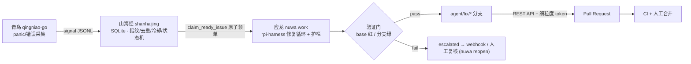

# Nuwa（女娲）· 补天

> 天有裂缝，炼石补之。

**Nuwa 是一个自愈式修复 Agent**：面向个人私有系统群，问题单进、PR 出的无人值守流水线——运行时故障不再靠人肉翻日志、人肉改码，而是由专职 runner 从"发现问题"走到"补丁合入"，CI 与人工合并是最终闸门。

## 它如何工作



设计原则：**现场永远只采集，修复恒在服务端**；语言无关（agent 本体零语言假设，语言差异推到采集 parser 与 runner 工具链）；自主开 PR 的前提是五件套护栏（分支隔离、频控/预算、CI 闸门、禁改路径、复现验证证据）。

## 组件宇宙

| 组件 | 代码名 | 职责 |
|---|---|---|
| 青鸟 | `sdk/qingniao-go` | 现场薄采集 SDK：panic/错误捕获 → 统一信封上报。只采集，不做任何策略 |
| 山海经 | `crates/shanhaijing` | 问题单库：指纹（Go/Java/Rust 栈归一化）、去重、冷却、优先级、状态机 |
| 应龙 | `crates/nuwa` | runner：领单 → 修复循环（vendored rpi-harness）→ 验证门 → 交付 |
| 五色石 | `nuwa deliver` | 补丁 + 验证证据封装：分支、提交、PR 正文（根因/改动/证据） |

运行时内核 vendored 自 [bigfish1913/pi-rust](https://github.com/bigfish1913/pi-rust)（MIT，`pi` SDK 的 Rust 重写），裁剪保留 5 crate（`crates/rpi-*`），tag `vendored/pi-rust-0.3.24` 锁定，上游选择性 cherry-pick。

## 快速上手

```bash
cargo build -p nuwa

# 离线跑通全链路（无需任何凭证，demo 状态放 spike/ 下不污染工作区）
nuwa ingest --signal spike/signal.json --db spike/demo.db
nuwa work  --db spike/demo.db \
           --instructions spike/target-repo/nuwa.repo.json --provider faux
```

`--provider anthropic`（配 `ANTHROPIC_API_KEY`）或 `--provider zai`（配 `ZAI_API_KEY`）切换真实 LLM；`--pr`（配 `NUWA_GITHUB_TOKEN`）在验证门通过后真实开 PR。首次接入先跑 `nuwa check --instructions <repo>/nuwa.repo.json` 验证指令文件。完整接入步骤见 [docs/08-onboarding.md](docs/08-onboarding.md)。

## Web 控制台（前端开发）

前端源码在 `web/`（Vite + React + TypeScript + Tailwind 4）。`npm run build` 产出 `web/dist`，`nuwa serve` 将其嵌入并在站点根路径 `/` 提供：`/` 即控制台（SPA），`/settings` 是 SPA 设置页；旧书签 `/ui*` 永久重定向到 `/`，`/issue/{fp}` 重定向到 `/issues/{fp}`（旧服务端渲染控制台已于 0.2.0 移除）。开发时先启动 `nuwa serve`（默认 7321），再：

```bash
cd web
npm ci
npm run dev      # http://localhost:5173；/api 与 /ingest 代理到 127.0.0.1:7321
npm run typecheck
npm test
npm run build    # typecheck + vite build → web/dist
```

Vite 代理使用 `changeOrigin: false` 保留 Host/Origin，否则浏览器写请求会被同源校验拒绝。未配置 `NUWA_UI_TOKEN` 时控制台进入本地模式；配置后首次访问会跳转 `/login` 用 UI 令牌换取 HttpOnly 会话。

## 当前状态（2026-10-20）

| 能力 | 状态 |
|---|---|
| 采集 → 指纹 → 去重 → 领单 → 修复 → 验证门 → 分支 | ✅ 离线 + 真实 panic 信号全链路实测 |
| 真实 LLM 修复 | ✅ anthropic / zai 真实闭环（spike #3/#5/#6；mindloop #7） |
| 自动开 PR | ✅ GitHub REST API + 细粒度 token；PR #7 已合并进 mindloop main |
| 验证门 | ✅ base 红 / 分支绿；可选 `reproduce_check` / `.nuwa/repro.sh`；交付面 glob 禁改终检 |
| 基线/分支生命周期 | ✅ 每周 fetch + reset、失败回滚、终态分支清理 |
| 密钥与子进程 | ✅ 启动清秘、bash/验证 env 白名单、PR/证据/转录脱敏 |
| 人的闭环 | ✅ `ignored` 终态、attempt cap、reopen reason + 历史回灌 |
| 无人值守 | ✅ pr_open 自动对账、HMAC webhook（escalated/ignored/heartbeat_stale/ci_red/sync_error/pr_opened） |
| 并发 runner | 原子领单 + repo 过滤就绪；串行执行，并发池/镜像矩阵待做 |
| 验证探针协议（A-4） | 刻意推迟——等第一个真实环境特定 bug 出现再设计 |

AI coding agent 在本仓库工作？先读 [AGENTS.md](AGENTS.md)。设计与决策记录见 [docs/](docs/README.md)（ADR 在 docs/04）。

## License

MIT。含 vendored [pi-rust](https://github.com/bigfish1913/pi-rust) 衍生代码（其谱系：[earendil-works/pi](https://github.com/earendil-works/pi)）。
