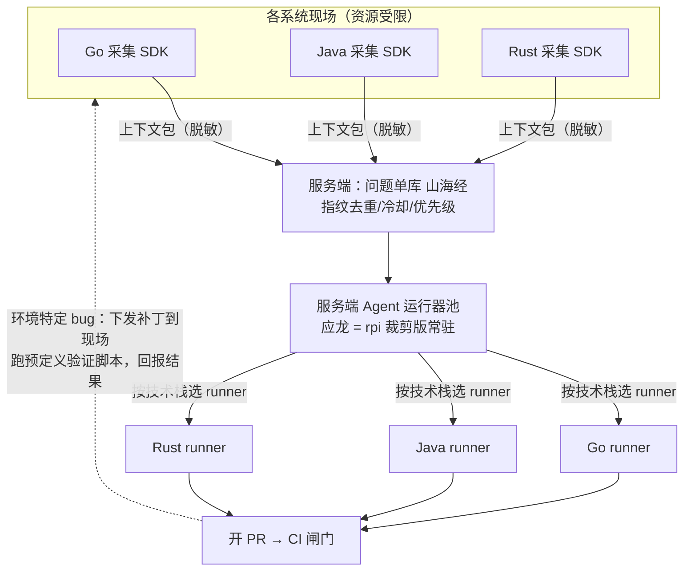

# 03 · 架构共识

状态：已确认（2026-10-15）；运行器池调度等细节见 [07-open-items.md](07-open-items.md)

## 总览



## 演进过程（记录被否决的中间形态）

1. **初版设想**：agent 嵌入各系统进程内，"现场修复"。→ 被否决：生产现场通常只有构建产物没有源码；资源受限环境装不下开发运行时；LLM 密钥与 shell 执行面扩散到每个现场。
2. **两模式折中**：现场具备条件则现场修复，否则上传服务端。→ 被否决："具备源码 + 工具链的现场"本质就是 runner，两套 agent 部署形态成本翻倍。
3. **最终收敛**：**现场永远只采集，修复恒在服务端**；"模式轴"切在验证位置——现场仅保留下发**预定义验证脚本**的权利（打补丁、跑复现、回报 pass/fail），绝不把自由 agent 派到现场。

## 组件职责

| 组件 | 神话名 | 职责 | 技术形态 |
|---|---|---|---|
| 现场采集 SDK | 青鸟 Qingniao | 采集运行时问题信号 → 指纹化 → 打包上下文 → 上报 | 按系统语言编写的薄库（Go/Java/…各一），无 LLM、无 shell 执行 |
| 问题单库 | 山海经 Shanhaijing | 指纹去重、冷却窗口、优先级、状态机、问题单存储 | 服务端组件（存储选型待定） |
| Agent 运行器池 | 应龙 Yinglong | 领取问题单 → 在目标仓库上定位/复现/修改/验证 → 开 PR | rpi 裁剪版（rpi-agent + rpi-ai + rpi-tools + rpi-harness） |
| 补丁单元 | 五色石 Wuse Stone | 一次修复产出的补丁及其验证证据的封装 | 补丁格式 + 元数据规范（待设计） |
| 验证探针 | （命名待定） | 环境特定 bug：服务端下发预定义验证脚本到现场执行并回报 | 现场只执行固定脚本，不运行自由 agent |

## 修复流水线（单问题单生命周期）

```
问题单就绪 → 领取（预算闸：token 上限 + 每仓库每日 PR 上限）
  → runner 选型（按仓库技术栈）
  → clone 目标仓库（私有，deploy key）
  → 读取仓库指令文件（构建/测试命令、代码规范、禁改路径）
  → 定位与复现（结合上下文包）
  → 修改（五色石：补丁 + 修改说明）
  → 验证（跑仓库测试命令；不足则以"复现验证证据"强制要求）
  → 开分支 agent/fix/<issue-fingerprint> → 直接开 PR（正文含问题单链接、根因摘要、改动清单、验证结果）
  → CI 闸门：不过测试 → 自动关 PR，问题单回炉升级给所有者
```

## 安全与护栏（自主开 PR 的前提，缺一不可）

1. 分支命名空间隔离：`agent/fix/*`，永不碰 `main` 等保护分支
2. 每仓库每日 PR 上限 + 每问题单 token 花费上限（接 rpi-harness budget 钩子）
3. 合并闸门交给 CI：PR 必须过测试，人工合并
4. 禁改路径清单：部署配置、密钥、迁移文件等直接拒绝修改
5. 复现验证证据：无验证结果的补丁不允许提 PR
6. 上下文包与日志上报全程脱敏（密钥/敏感数据不进 LLM 上下文）
