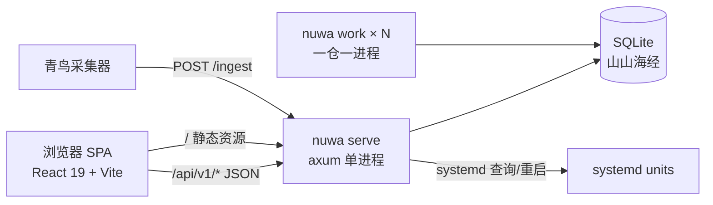

# 09 · Web 控制台设计（v3）

状态：已定稿（2026-10-17）。替代 v2（2026-10-16）。实施状态：未开始。

决策摘要：

- **形态**：`nuwa serve` 内托管 React 19 + TypeScript + Vite 单页应用；JSON API `/api/v1`；前端产物 `rust-embed` 编进单二进制。
- **鉴权**：登录页 + HMAC 签名 HttpOnly 会话 Cookie + CSRF 双提交；不再是 Basic Auth。
- **可观测**：一仓一进程不变，新增 runner 身份、后台心跳、run 生命周期、按日信号聚合；支持卡单识别与人工重排。
- **交付**：M0 线上 P0 热修独立发布；M1–M6 完成后一次性替换旧控制台，随 v0.2.0 发布。
- **保留**：设置页仍以 `nuwa.env` 为唯一事实源、重启由 systemd 编排（v2 D3）；UI 令牌与上报令牌分离（v2 D2）。
- **替代**：v2 D1「挂 serve 进程内服务端渲染、零 JS 框架」。

## 0 · 版本演进

| 版本 | 日期 | 形态 | 结论 |
|---|---|---|---|
| v1 | 2026-10-16 | `serve` 内嵌单页 SSR | 打通"问题单可见" |
| v2 | 2026-10-16 | 三页 SSR（总览/详情/设置）+ G1–G5 + D2 独立 UI 令牌 | 上线 v0.1.5；实测暴露 P0 缺陷与运维盲区 |
| v3 | 2026-10-17 | SPA + JSON API + 会话鉴权 + runner 遥测 | 本文档 |

v2 的 D2（UI 令牌与上报令牌分离）与 D3（env 文件为唯一事实源 + 重启编排）继续有效；D1（SSR 零 JS）被本版替代。

## 1 · 定位

控制台是自愈系统的**地面站**，只服务所有者一人。它必须让无人值守可信（可见）、在系统承认需要人时接手（处置）、把边界配置集中（治理）、让每次修复可回溯（审计）。

控制台不是通用监控，也不是 GitHub 的替代品：

- PR 审查、合并、CI 重跑仍在 GitHub；控制台只展示结论并深链。
- 不做指标采集与告警路由；只消费山海经中的问题单、运行与事件。
- 不做多用户、RBAC、第三方 SaaS。

## 2 · 用户与四个打开时刻

| 时刻 | 问题 | 入口 |
|---|---|---|
| 例行巡视 | 系统还健康吗？机器在干什么？ | 总览 |
| 事件响应 | 什么需要我？下一步做什么？ | 总览"需要你处理" → 详情 |
| 审计回溯 | 这次修复做了什么、证据在哪？ | 详情 → 证据/会话 |
| 边界治理 | 配置对不对？改动何时生效？ | 设置/运行器/活动 |

## 3 · 目标与非目标

### 3.1 目标

1. **运维可见性**：每个仓库的 runner 活着、在修哪条单、卡在哪个阶段、今日配额用了多少，一屏可答。
2. **卡单处置**：`triggered` / `fixing` 卡死可识别、可一键重排；`escalated` / `rejected` 可复核后重开。
3. **配置与安全**：修复 env 键错误、反射型 XSS、CSRF；配置有校验、连接测试、生效差异、重启保护与审计。
4. **易用与视觉**：信息架构、响应式、搜索/排序/分页、证据链、会话转录、双主题与无障碍。
5. **多仓库与趋势**：按仓库聚合 runner/配额/问题单，展示上报、PR、合并、拒绝、token 的趋势。

### 3.2 非目标

- 多仓库并发池（docs/07 A-3 后半）、runner 镜像矩阵。
- GitHub OAuth、PR 内联审查/合并、CI 重跑。
- 多用户/RBAC、对外 SaaS。
- 指标采集、告警路由、Prometheus 端点。
- 仓库在线注册与在线编辑 `nuwa.repo.json`。
- SSE/WebSocket、CSV 导出、批量操作、移动原生 App。

## 4 · 现状诊断（v3 的直接动因）

以下缺陷均在 v0.1.5 实现与本机实测中确认：

| 级别 | 问题 | 位置/证据 |
|---|---|---|
| P0 | 设置页读写小写 `nuwa_*` 键，进程只读大写 `NUWA_*`。已有配置显示为空，保存后对 runner 无效 | `settings.rs` `ENV_KEYS` vs `main.rs` `env_d("NUWA_…")`；本地 POST 后 env 文件出现小写键 |
| P0 | 总览筛选说明直接把 query 参数拼进 HTML，反射型 XSS | `ui.rs` `state_note` 构造与插入；`?state=` 原样回显 |
| P0 | 所有写操作无 CSRF 防护；Basic 凭证会被浏览器自动携带 | `/ui/reopen`、`/ui/sync`、`/settings/save`、`/settings/restart` |
| P1 | rejected 问题单展示 reopen 按钮，但 POST 只允许 escalated，点击返回 409 | `ui.rs` `reopen` 状态检查 |
| P1 | 配额耗尽在写心跳之前提前返回，"主动待命"被误判为"机器已死" | `work_once` 配额闸与 `store.heartbeat` 的顺序 |
| P1 | 心跳是全局单行，多仓库互相覆盖；修复进行中不续跳，长修复看起来像死了 | `shanhaijing` heartbeat 表；`work_once` 只在领单前写 |
| P1 | `triggered`/`fixing` 无人工恢复路径，进程被杀后永远卡住 | 状态机无 `triggered/fixing → new` |
| P1 | 重启按钮可在修复中杀掉 work，无确认、无活动 run 检查 | `settings.rs` `restart_services` |
| P2 | 漏斗窄屏换行散架、箭头几乎不可见；标题列被挤成一词一行 | 本地 600px 实测 |
| P2 | 活动流被同指纹 `reported dedup` 刷屏 | 每次上报写一条 event |
| P2 | 详情页缺验证证据、diff、CI 结论、token/耗时、会话 | 只有时间线 + 堆栈 + PR 链接 |
| P2 | 无搜索/排序/分页；三页 HTML/CSS 各自内联重复 | `ui.rs` / `settings.rs` |

结论：问题不是"换皮"，而是信息模型不足以支撑运维，且存在必须修的安全与状态缺陷。

## 5 · 架构

### 5.1 运行形态



- 单二进制、单端口、无外部服务；TLS 仍由前置代理按需终止。
- `nuwa serve` 同时提供：SPA 静态资源、JSON API、ingest、health。
- `nuwa work` 一仓一进程不变；新增 runner 遥测写入。
- 生产/开发都不要求 Node 常驻；Node 只在构建期使用。

### 5.2 后端模块

```
crates/nuwa/src/
  serve.rs          # 路由、AppState、中间件（替换 main.rs 的 run_serve）
  session.rs        # 会话签名/校验、CSRF、登录限速
  api/
    mod.rs          # 路由聚合、统一错误、请求日志
    auth.rs         # login/logout/me
    overview.rs     # 漏斗、需处理、活动 run、队列、健康摘要
    issues.rs       # 列表、详情、时间线、reopen/requeue、转录
    runners.rs      # 列表、重启
    events.rs       # 事件分页/过滤/聚合
    settings.rs     # schema、读写、测试、重启
    system.rs       # 版本、DB、uptime、systemd
    trends.rs       # 趋势桶
  web.rs            # rust-embed、SPA fallback、缓存与安全头
  settings.rs       # env schema、大小写迁移、原子写入（保留文件名）
  main.rs           # CLI + work 遥测接线
crates/shanhaijing/src/
  lib.rs            # 既有 Store 扩展
  migration.rs      # PRAGMA user_version 有序迁移
web/
  package.json / package-lock.json / vite.config.ts / tsconfig.json
  index.html
  src/
    app/            # 路由、AppShell、Providers
    components/     # 设计系统原语
    features/       # overview/issues/issue-detail/runners/events/settings
    lib/            # api client、query keys、format、auth
    styles/tokens.css
```

约束：

- SQL 只在 `shanhaijing` crate；API handler 不写裸 SQL。
- 既有 `repair.rs` / `deliver.rs` / `guard.rs` 的修复与护栏行为不变；只增加遥测返回值与进度回调。
- vendored `crates/rpi-*` 零改动。
- 新依赖必须兼容 workspace MSRV（当前 1.79）；若某个前端/服务端依赖要求更高，先评估并同步提升 `rust-version`（CI 使用 stable），在本设计实施记录中注明。

### 5.3 前端

- React 19 + TypeScript + Vite；React Router（路由）；TanStack Query（服务端状态与轮询）；Zod（表单校验）；Tailwind CSS v4 + 设计令牌；lucide-react 图标；clsx。
- **不引入组件库**（避免模板化外观与体积）；在 `components/` 内自建 Button/Badge/Card/Table/Dialog/Toast/Field 等原语。
- 图表自绘 SVG，不引图表库。
- 无 Redux；服务端状态归 Query，UI 状态本地化。
- 所有文本中文优先；时间用 `Intl.DateTimeFormat` 本地化，数据存储与 API 用 UTC epoch ms。

### 5.4 构建与嵌入

- `web/` 独立 npm 工程，提交 `package-lock.json`；`web/node_modules`、`web/dist/*` 不提交，但提交 `web/dist/.gitkeep` 以保证 fresh clone 的 `cargo build` 能编译。
- release：Node 24 → `npm ci` → `npm run build` → `cargo build --release`；`rust-embed` 在 release 编入 `web/dist`。
- debug：`rust-embed` 从磁盘读取 `web/dist`；本地开发用 `npm run dev`（Vite 5173，代理 `/api` 与 `/ingest` 到 7321）。未构建前端时返回一段"请先构建前端"的提示文本，不返回 500。
- SPA fallback：仅对非 `/api`、非 `/ingest`、非 `/health`、且不带文件扩展名/非 `assets/` 前缀的 GET 返回 `index.html`；其余未命中返回 404。
- 缓存：`assets/*`（带 hash）一年 immutable；`index.html` no-cache；API no-store。
- 依赖：`axum-extra`（cookie）、`hmac` + `subtle`（会话）、`rust-embed` + `mime_guess`（资源）、`tower-http`（压缩/安全头/请求日志）。

### 5.5 兼容与回滚

- 旧 `/ui`、`/issue/:fp`、`/settings` 在 v0.2.0 中移除。
- 旧 `heartbeat` 表保留；`work` 在 v0.2.x 内继续 best-effort 写全局心跳，便于回滚到旧二进制。v0.3 删除双写与旧表。
- 数据库迁移只增列/增表，不删不改语义；回滚到旧二进制时旧代码仍可读写核心表。
- 部署前保留 `nuwa.prev` 与停服 DB 备份。

## 6 · 鉴权与安全

### 6.1 登录态

- `POST /api/v1/auth/login { "token": "…" }`：与生效的 UI 令牌比较（`NUWA_UI_TOKEN`，未设则 fallback `NUWA_INGEST_TOKEN`）。
- 成功返回 `204` 并设置：
  - `nuwa_session`：`HttpOnly; SameSite=Strict; Path=/; Max-Age=<NUWA_SESSION_TTL_SECS>`（默认 86400）；`NUWA_COOKIE_SECURE=always`，或 `auto` 且请求带可信 `X-Forwarded-Proto: https` 时加 `Secure`。直接 HTTP 部署使用 `auto` 不会加 Secure；生产建议 TLS 代理 + `always`。
  - `nuwa_csrf`：非 HttpOnly，供双提交读取；`SameSite=Strict; Path=/; Max-Age=<NUWA_SESSION_TTL_SECS>`。
- 会话值：`v1.<exp_ms>.<nonce>.<hmac_sha256(key, "v1.<exp_ms>.<nonce>")>`，base64url。`key = SHA256(ui_token)`；改 UI 令牌即全部会话失效。
- `GET /api/v1/auth/me`：返回 `{ authenticated, local_mode, expires_at_ms }`；若 CSRF Cookie 缺失则补发。
- `POST /api/v1/auth/logout`：清除两个 Cookie。

### 6.2 本地模式

- `NUWA_UI_TOKEN` 与 `NUWA_INGEST_TOKEN` 均为空时进入本地模式：API 视为已认证（`local_mode=true`），不显示登录页，但**仍下发 CSRF Cookie 并要求写操作携带令牌**，防止本机浏览器被跨站写。
- 生产必须设置 UI 令牌；`/api/v1/system` 在本地模式下给出醒目警告。

### 6.3 CSRF 与同源

- 除 `/auth/login`（登录引导，尚无会话）外，所有 `POST/PUT/PATCH/DELETE` 要求：
  - `nuwa_csrf` Cookie 存在；
  - `X-NUWA-CSRF` 头与 Cookie 常量时间相等；
  - 若带 `Origin`，其 host 必须与请求 `Host` 一致（前置代理需保留 Host）。
- 失败返回 `403 forbidden`，不泄露细节。
- 不使用 `Authorization: Basic`；不提供 CORS。

### 6.4 登录限速

- 每 IP 5 次失败 / 10 分钟；成功清零。超限返回 `429 rate_limited` 与 `Retry-After`。
- 进程内 `Mutex<HashMap<IpAddr, LoginBucket>>`，定期清理过期项；单进程部署足够。
- 令牌比较使用常量时间实现（`subtle`）。

### 6.5 安全响应头与 CSP

```
Content-Security-Policy: default-src 'self'; script-src 'self'; style-src 'self';
  img-src 'self' data:; font-src 'self'; connect-src 'self';
  frame-ancestors 'none'; base-uri 'none'; form-action 'self'
X-Content-Type-Options: nosniff
Referrer-Policy: no-referrer
X-Frame-Options: DENY
Permissions-Policy: camera=(), microphone=(), geolocation=()
```

- 前端不使用内联 `<script>` / `style`；动态颜色通过类名或数据属性，不用 `style=`。
- 主题初始化用独立的 `theme-init.js`（`public/`，由 Rust 以静态资源提供）。
- 开发模式（Vite 5173）不施加生产 CSP；生产由 `web.rs` 统一加。

### 6.6 密钥处理

- API 只返回 `{ set, last4, updated_at_ms }`；永不返回完整密钥。
- 事件、日志、审计只记录 key 名，不记录值。
- 设置写回保留注释与未知键；Unix 下 `chmod 600`；临时文件 + rename 原子替换。
- 请求日志不记录 body、Cookie、Authorization。

## 7 · 数据模型

### 7.1 迁移

- `PRAGMA user_version` 从 0 开始；`migration.rs` 定义有序迁移，事务内执行，幂等。
- 打开连接即设置：`journal_mode=WAL`、`busy_timeout=5000`、`synchronous=NORMAL`、`foreign_keys=ON`。
- v0 → v1：
  1. `issues` 增 `state_changed_at INTEGER NOT NULL DEFAULT 0`、`owner_runner_id TEXT`。
  2. `events` 增 `repo TEXT`、`actor TEXT`。
  3. 新建 `runners`、`runs`、`signal_daily`。
  4. 建索引。
  5. 回填：`state_changed_at = COALESCE(最近 state_changed 事件 ts, last_seen)`；`events.repo` 从 issues 回填。
  6. `PRAGMA user_version = 1`。
- 不建议删除旧列/旧表；旧 `heartbeat` 表保留到 v0.3。

### 7.2 `issues` 增列

| 列 | 类型 | 含义 |
|---|---|---|
| `state_changed_at` | INTEGER | 最近一次状态迁移时间（ms），用于卡单判定 |
| `owner_runner_id` | TEXT | 当前或最近一次领取该单的 runner；重排时清空 |

所有 `set_state` 同时写 `state_changed_at`；回归重开、reopen、requeue 都清空 owner 与冷却。

### 7.3 `runners`

```sql
CREATE TABLE IF NOT EXISTS runners (
    id                  TEXT PRIMARY KEY,
    repo                TEXT NOT NULL,
    host                TEXT NOT NULL,
    pid                 INTEGER,
    started_at          INTEGER NOT NULL,
    heartbeat_at        INTEGER NOT NULL,
    status              TEXT NOT NULL,          -- starting|idle|working|standing_down|error
    current_fingerprint TEXT,
    phase               TEXT,                   -- claim|repair|verify|deliver|ci
    provider            TEXT,
    model               TEXT,
    daily_pr_limit      INTEGER,
    repo_path           TEXT,
    service_unit        TEXT,
    config_json         TEXT NOT NULL DEFAULT '{}',
    last_error          TEXT
);
```

- `config_json` 存放 runner 实际生效的非敏感配置（`interval_secs`、`ci_timeout_secs`、`max_turns`、`max_tokens`、`failing_check`、`forbidden_paths_count` 等），供设置页做「文件值 vs 运行值」对比；**不得写入任何密钥**。
- `offline` 不落库：`now - heartbeat_at > max(3 × 心跳间隔, 90s)`，心跳间隔 = `max(5s, min(15s, interval))`；由 API 计算。
- `status=standing_down` 表示配额耗尽主动待命；`error` 表示最近一次环境/预检错误，进程可能已被 systemd 重启。

### 7.4 `runs`

```sql
CREATE TABLE IF NOT EXISTS runs (
    id                TEXT PRIMARY KEY,         -- Nuwa 生成的 attempt id
    harness_run_id    TEXT,
    fingerprint       TEXT NOT NULL,
    runner_id         TEXT NOT NULL,
    repo              TEXT NOT NULL,
    started_at        INTEGER NOT NULL,
    finished_at       INTEGER,
    phase             TEXT NOT NULL,            -- claim|repair|verify|deliver|ci|done
    outcome           TEXT,                     -- success|repair_failed|budget_exceeded|
                                                -- delivery_failed|ci_red|interrupted|aborted
    ci_verdict        TEXT,                     -- success|failure|timeout|unavailable
    turns             INTEGER DEFAULT 0,
    tokens_uncached   INTEGER DEFAULT 0,
    tokens_cached     INTEGER DEFAULT 0,
    provider          TEXT,
    model             TEXT,
    root_cause        TEXT,
    change_stat       TEXT,
    branch            TEXT,
    commit_sha        TEXT,
    pr_url            TEXT,
    pr_opened_at      INTEGER,
    verification_ok   INTEGER,
    verification_detail TEXT,
    session_dir       TEXT,
    error             TEXT
);
```

- 领单即插入 `runs` 行；进程被杀会留下 `finished_at IS NULL`。work 启动时把本 runner 名下未完成的 run 标记 `outcome=interrupted`、`finished_at=now`。
- `verification_detail` 与 `change_stat` 截断存储（建议 16KB / 4KB），完整证据仍在 `sessions/<short_fp>/verification.txt`。
- 失败路径同样落库：`repair_failed` / `budget_exceeded` / `delivery_failed` 把错误链截断（建议 16KB）写入 `error`；验证门失败时错误文本包含检查输出摘要。
- `session_dir` 由服务端生成，API 从不接受客户端路径。

### 7.5 `signal_daily`

```sql
CREATE TABLE IF NOT EXISTS signal_daily (
    fingerprint TEXT NOT NULL,
    repo        TEXT NOT NULL,
    day         TEXT NOT NULL,                  -- YYYY-MM-DD (UTC)
    count       INTEGER NOT NULL DEFAULT 0,
    PRIMARY KEY (fingerprint, repo, day)
);
```

- 每次上报 upsert `count + 1`；替代"每次 dedup 写一条 event"。
- 趋势页与"今日上报"统计直接读此表。
- 首次上报、回归、状态迁移仍写 `events`。

### 7.6 `events` 增列

| 列 | 类型 | 含义 |
|---|---|---|
| `repo` | TEXT | 事件所属仓库；配置/系统事件为空 |
| `actor` | TEXT | `owner` / `runner` / `system`；历史事件为 NULL |

新增事件 kind：`requeued`、`config_migrated`、`restart_requested`、`runner_started`、`runner_stopped`、`runner_error`。保留既有：`reported`、`state_changed`、`pr_opened`、`ci_green`、`ci_red`、`ci_timeout`、`merged`、`config_changed`。

系统事件的合成指纹：配置变更/迁移用 `__config__`，重启请求用 `__system__`，runner 生命周期用 `__runner__:<runner_id>`。控制台遇到这些前缀时显示"系统"标签，不当作问题单链接。

`record_event` 签名扩展为 `(fingerprint, repo, actor, kind, detail)`；既有调用点补齐 repo/actor。历史行 `repo`/`actor` 为 NULL，读取时按空处理。

### 7.7 索引与保留

```sql
CREATE INDEX idx_issues_state_last ON issues(state, last_seen DESC);
CREATE INDEX idx_issues_repo_last  ON issues(repo, last_seen DESC);
CREATE INDEX idx_events_ts         ON events(ts DESC);
CREATE INDEX idx_events_kind       ON events(kind, ts DESC);
CREATE INDEX idx_runs_fp           ON runs(fingerprint, started_at DESC);
CREATE INDEX idx_runs_started      ON runs(started_at DESC);
CREATE INDEX idx_signal_day        ON signal_daily(day, repo);
```

- 每日清理：`events` 超过 `NUWA_EVENT_RETENTION_DAYS`（默认 90）、`runs` 超过 365 天；审计事件（`config_changed`/`config_migrated`/`restart_requested`）保留 365 天。
- `runners` 中离线超过 30 天的行清理；在线/最近活跃的保留。
- 清理失败不影响主流程；记录一次 `runner_error`/标准错误输出即可（不写事件，避免自激）。

### 7.8 Store 方法（新增/调整）

- 迁移：`migrate()`。
- runner：`upsert_runner`、`heartbeat_runner`、`set_runner_status`、`list_runners`。
- run：`start_run`、`update_run_phase`、`update_run_progress`、`finish_run`、`mark_interrupted`、`latest_run`、`runs_for`。
- 查询：`counts`、`list_issues(filter)`、`attention`、`similar_issues`、`trends(range)`。
- 动作：`reopen(fingerprint, actor)`、`requeue_stuck(fingerprint, force, actor)`。
- 信号：`report_signal` 内改为 `signal_daily` upsert；首次/回归事件照旧。
- 保留既有 `claim_ready_issue`、`set_state`、`set_pr` 等；`prs_opened_since` 改为按 PR URL 去重统计（`runs` 为主，迁移前 `issues.pr_opened_at` 回退）。

## 8 · 运行器遥测与卡单处置

### 8.1 身份

- `nuwa work` 新增：
  - `--runner-id` / `NUWA_RUNNER_ID`，默认 `"{hostname}:{repo}"`，只允许 `[A-Za-z0-9._:-]`。
  - `--service-unit` / `NUWA_SERVICE_UNIT`，默认 `nuwa-work`，用于控制台重启。
- 启动即 `upsert_runner`；同一 id 多进程属于配置错误，文档明确唯一性要求。
- 若多个 runner 共用同一 systemd unit，控制台重启该 unit 会影响全部；部署建议一 runner 一 unit（或 systemd 模板），页面在重启确认中显示影响范围。

### 8.2 心跳

- 后台任务每 `max(5s, min(15s, interval))` 更新：
  - `heartbeat_at`、`status`、`current_fingerprint`、`phase`；
  - `turns`/`tokens`（修复中由进度回调提供）；
  - `provider`/`model`/`daily_pr_limit`/`repo_path`/`service_unit`，以及 `config_json` 中的非敏感有效配置（interval/ci_timeout/max_turns/max_tokens/check/禁改路径数量）。
- 主循环的每个阶段也立即更新一次，不等定时器。
- 配额耗尽：`status=standing_down` 且继续心跳；不得在心跳前提前 return。
- 预检失败：写 `status=error` + `last_error` + 心跳后退出；systemd 重启后再次注册。

### 8.3 run 生命周期与进度

1. 领单成功：`start_run(id=uuid, fingerprint, runner_id, repo, started_at, phase=claim)`，设置 issues `owner_runner_id`。
2. 开始修复：`phase=repair`；`RepairJob` 增加 `progress: Option<Arc<dyn Fn(RepairProgress) + Send + Sync>>`，事件汇在每次 `TurnEnd` 回调 `{turns, uncached_tokens, cached_tokens}`；心跳任务每 5s 落库。`RepairReport` 增加 `session_dir`；`DeliverReport` 增加 `verification_detail` 与 `change_stat`。
3. 修复完成：写入 `harness_run_id`、`turns/tokens`、`root_cause`、`session_dir`、`phase=verify`。
4. 验证/交付：写入 `verification_ok/detail`、`change_stat`、`branch/commit/pr_url/pr_opened_at`、`phase=ci`。
5. CI：写 `ci_verdict`；成功 `outcome=success`；红 `outcome=ci_red`；超时/不可读 `outcome=success` + `ci_verdict=timeout|unavailable`，问题单保持 `pr_open` 等人工处理。
6. 完成：`phase=done`、`finished_at`。

升级 detail 前缀统一：`repair_failed:`、`delivery_failed:`、`budget_exceeded:`、`ci_red:`，供 attention 的 `reason_code` 稳定映射。

遥测写入全部 **best-effort**：失败只写 stderr，不阻断修复/交付。

### 8.4 卡单判定

```
healthy_owner = owner 存在
                AND owner.status = 'working'
                AND owner.current_fingerprint = fp
                AND now - owner.heartbeat_at <= stuck_after

stuck = state ∈ {triggered, fixing}
        AND NOT healthy_owner
        AND now - max(state_changed_at, owner.heartbeat_at or 0) > stuck_after

stuck_after = max(3 × interval, 300s)   // NUWA_STUCK_AFTER_SECS 可覆盖
```

- owner 不存在（NULL 或 runner 已删除）时只用 `state_changed_at`。
- owner 心跳新鲜、状态 working、`current_fingerprint` 匹配 → 不判卡单（长修复正常）。
- owner 已 idle/standing_down/error 或已转向别的单，且超过阈值 → 判卡单。
- 总览"需要你处理"新增 `stuck` 项；问题单列表可筛 `stuck=1`。
- **只识别、不自动重排**。原因：无法证明另一个 runner 一定不在工作；自动重排可能双开分支/PR。

### 8.5 动作语义

| 动作 | 允许的起始状态 | 结果 | 附加 |
|---|---|---|---|
| `reopen` | `escalated`、`rejected` | → `new` | 清冷却、清 owner、事件 `state_changed` detail=`reopened by owner` |
| `requeue` | `triggered`、`fixing` | → `new` | 仅当 `stuck`；`force=1` 可跳过卡单检查；清冷却/owner；事件 `requeued` |
| 非法状态 | 其他 | `409 invalid_state` | 不改变数据 |

- 两个动作都走 Store 内的显式方法，不把 `triggered/fixing → new` 加进通用 `can_transition`，避免 runner 误用。
- 动作后由 runner 下一轮正常 `claim_ready_issue` 领取。

### 8.6 配额与待命

- `NUWA_DAILY_PR_LIMIT` 仍是每仓库每日 PR 上限（UTC 日窗口）。
- `runners` 心跳上报 `daily_pr_limit`；API 按 **PR URL 去重**统计 `prs_today`：优先 `runs.pr_opened_at`，迁移前的历史数据回退 `issues.pr_opened_at`。不能只数 issues，否则同指纹回归重开第二个 PR 会少计。
- 控制台展示"今日 2/5"；待命时明确文案"配额已用完，UTC 次日自动恢复"，不显示为故障。
- 配额检查前先写 `standing_down` 心跳（或把心跳前移）——修复 v2 的误判。

### 8.7 多仓库展示

- 不引入仓库注册表；仓库列表由 `runners` 与 `issues` 派生。
- 每仓库展示：runner 在线状态、当前单、配额、最近错误、checkout 路径、`failing_check`（由 runner 心跳写入 `config_json` 上报）。
- 同一仓库多 runner 的情况允许显示，但本期部署约定一仓一进程；UI 不假设唯一。
- 总览、问题单、趋势均支持 repo 过滤。

## 9 · API 契约（v1）

### 9.1 约定

- 前缀 `/api/v1`；除 `auth/login` 外均需会话（本地模式除外）。
- JSON；请求/响应 UTF-8；时间 epoch ms（UTC）。
- 列表分页：`page`（1 起）、`page_size`（默认 50，最大 200）；响应 `meta.total`。
- 排序：`sort=last_seen|first_seen|occurrences|severity|state`，`order=asc|desc`；severity 按 critical>high>medium>low 权重，state 按生命周期顺序。
- 错误：

```json
{ "error": { "code": "invalid_state", "message": "state is pr_open, not escalated/rejected", "fields": {} } }
```

| code | HTTP | 场景 |
|---|---|---|
| `unauthorized` | 401 | 未登录/会话过期 |
| `forbidden` | 403 | CSRF/同源校验失败 |
| `not_found` | 404 | 指纹/runner 不存在 |
| `invalid_state` | 409 | 动作与当前状态不符 |
| `conflict` | 409 | 并发 sync/重复动作 |
| `validation_failed` | 422 | 字段校验失败（`fields` 给出字段错误） |
| `rate_limited` | 429 | 登录限速 |
| `upstream_error` | 502 | GitHub/LLM 调用失败 |
| `not_supported` | 501 | 非 systemd 环境要求重启 |
| `internal` | 500 | 其他；不回显内部细节 |

### 9.2 端点

#### 认证

| 方法 | 路径 | 说明 |
|---|---|---|
| POST | `/auth/login` | body `{token}`；成功 204 + Cookie；失败 401/429 |
| POST | `/auth/logout` | 清 Cookie；需 CSRF |
| GET | `/auth/me` | 会话状态；补发 CSRF Cookie |

#### 总览

`GET /overview?repo=`

```json
{
  "counts": { "new": 2, "triggered": 0, "fixing": 1, "pr_open": 7, "merged": 1, "rejected": 0, "escalated": 0 },
  "attention": [
    { "fingerprint": "…", "title": "…", "state": "escalated", "severity": "high",
      "repo": "…", "last_seen_ms": 0, "stuck": false,
      "reason_code": "repair_failed", "reason_text": "修复 runner 失败，需要复核",
      "pr_url": null }
  ],
  "active_runs": [
    { "id": "…", "fingerprint": "…", "title": "…", "repo": "…", "runner_id": "…",
      "phase": "repair", "started_at_ms": 0, "turns": 6, "tokens": 17500 }
  ],
  "queue": { "ready_count": 3, "next": [{ "fingerprint": "…", "title": "…", "severity": "high", "occurrences": 17 }] },
  "health": { "runners_total": 2, "runners_online": 2, "working": 1, "idle": 1,
              "standing_down": 0, "error": 0, "reports_today": 12, "prs_today": 2 },
  "ci_24h": { "green": 12, "red": 1, "timeout": 0, "pending": 1 }
}
```

`ci_24h.pending` = 当前处于 `ci` 阶段的活跃 run 数；其余三项为过去 24h 的 `ci_green/ci_red/ci_timeout` 事件计数。

attention 排序：escalated > stuck > rejected > pr_open 且最近 24h 有 `ci_timeout`；同级按 `last_seen_ms` 升序（越久越靠前）。

`reason_code` 映射：

| reason_code | 来源 | 文案 |
|---|---|---|
| `repair_failed` | escalated detail 前缀 | 修复 runner 失败，需要复核 |
| `delivery_failed` | escalated detail 前缀 | 验证/交付失败，需要复核 |
| `budget_exceeded` | escalated detail 前缀 | token 预算超限，需要复核 |
| `ci_red` | escalated/rejected detail 前缀 | CI 红灯，PR 已关闭 |
| `pr_closed` | sync 写入的 rejected | PR 未合并被关闭 |
| `stuck` | 卡单判定 | 疑似卡单，runner 心跳已过期 |
| `ci_timeout` | 最近 24h 的 `ci_timeout` 事件 | CI 超时，需要人工查看 |

#### 问题单

`GET /issues?state=new,fixing&severity=high&repo=&language=&q=&stuck=1&attention=1&sort=last_seen&order=desc&page=1&page_size=50`

```json
{
  "data": [{
    "fingerprint": "…", "title": "…", "repo": "…", "language": "go",
    "severity": "high", "state": "fixing", "occurrences": 17,
    "first_seen_ms": 0, "last_seen_ms": 0, "state_changed_at_ms": 0,
    "pr_url": null, "ci_verdict": null, "owner_runner_id": "…", "stuck": false
  }],
  "meta": { "page": 1, "page_size": 50, "total": 12 }
}
```

- `ci_verdict` 取该问题单最近一次 run 的结论；无 run 时为 null。
- `attention=1` = `escalated` 或 `rejected` 或 `stuck` 或（`pr_open` 且 24h 内有 `ci_timeout`），与总览"需要你处理"同一集合。
- `q` 对 title 与 fingerprint 做 `LIKE`（转义 `%`/`_`），长度上限 128。
- `state` 逗号分隔；未知值返回 422。

`GET /issues/{fp}`

```json
{
  "issue": { "...": "同上" },
  "stack_sample": "…",
  "timeline": [{ "kind": "state_changed", "detail": "claimed by runner", "ts_ms": 0, "actor": "runner", "repo": "…" }],
  "runs": [{ "id": "…", "started_at_ms": 0, "finished_at_ms": 0, "phase": "done",
             "outcome": "success", "ci_verdict": "success", "turns": 6,
             "tokens_uncached": 17000, "tokens_cached": 500, "provider": "zai",
             "model": "glm-5.3-flash", "root_cause": "…", "change_stat": "…",
             "branch": "agent/fix/…", "commit_sha": "…", "pr_url": "…",
             "pr_opened_at_ms": 0, "verification_ok": true,
             "verification_detail": "…", "error": null }],
  "similar": { "count": 4, "items": [{ "fingerprint": "…", "state": "merged", "last_seen_ms": 0 }] }
}
```

- `runs` 返回最近 10 次，按 `started_at` 降序；`session_dir` 仅服务端使用，不在此响应中返回。
- `timeline` 默认最近 200 条；历史 `reported` 事件可按小时聚合并返回 `count` 字段（见 `/events?aggregate=1`）。
- `similar` 用完全相同 title，排除自身，最多 5 条。

`GET /issues/{fp}/transcript?run_id=&page=1&page_size=20`

```json
{
  "data": [{
    "seq": 21, "role": "assistant", "ts_ms": 0,
    "blocks": [
      { "type": "thinking", "text": "…" },
      { "type": "text", "text": "…" },
      { "type": "tool_call", "name": "read", "arguments": { "path": "calc.go" } },
      { "type": "tool_result", "name": "read", "text": "…", "is_error": false }
    ]
  }],
  "meta": { "page": 1, "page_size": 20, "total": 30, "truncated": false, "empty": false }
}
```

- `run_id` 省略时取该指纹最近一次有 `session_dir` 的 run；指定时必须属于该指纹，否则 404。
- 只解析 `kind=entry, type=message`；映射 user / assistant（thinking、text、toolCall）/ tool_result。
- 单条内容截断 16KB；总读取上限 2MB（超出取末尾并标记 `truncated=true`）；按消息分页。
- 无 run/无会话返回 `{ "data": [], "meta": { "empty": true } }`。

#### 动作

| 方法 | 路径 | body | 成功 | 失败 |
|---|---|---|---|---|
| POST | `/issues/{fp}/reopen` | `{reason?}` | 204 | 404/409 |
| POST | `/issues/{fp}/requeue` | `{force?: bool, reason?}` | 204 | 404/409/422 |
| POST | `/sync` | — | 200 汇总 | 409（并发）/502 |
| POST | `/runners/{id}/restart` | — | 202 | 404/501 |

`/sync` 响应：

```json
{ "checked": 7, "merged": 1, "rejected": 0, "still_open": 6,
  "errors": [{ "fingerprint": "…", "message": "actions runs 403" }] }
```

- 30s 超时；进程内互斥，已有 sync 时返回 409。
- 只更新已存储的 PR 状态；不创建/合并 PR。

#### 运行器

`GET /runners`

```json
{ "data": [{
  "id": "host:spike-target", "repo": "example.com/spike-target", "host": "host",
  "pid": 123, "started_at_ms": 0, "heartbeat_at_ms": 0,
  "status": "working", "offline": false,
  "current_fingerprint": "…", "phase": "repair",
  "provider": "zai", "model": "glm-5.3-flash",
  "daily_pr_limit": 5, "prs_today": 2,
  "repo_path": "/opt/nuwa/repo/spike-target",
  "service_unit": "nuwa-work", "last_error": null,
  "effective": { "interval_secs": 30, "ci_timeout_secs": 600, "max_turns": 30, "max_tokens": 1500000 }
}]}
```

#### 事件

`GET /events?kind=state_changed,ci_red&repo=&fingerprint=&from_ms=&to_ms=&aggregate=1&page=1&page_size=50`

```json
{
  "data": [{ "fingerprint": "…", "kind": "state_changed", "detail": "…", "ts_ms": 0,
             "repo": "…", "actor": "runner", "count": 1, "first_ts_ms": 0, "last_ts_ms": 0 }],
  "meta": { "page": 1, "page_size": 50, "total": 100 }
}
```

- `aggregate=1`：仅对历史 `kind=reported` 连续记录按 fingerprint + 小时合并，返回 `count/first_ts_ms/last_ts_ms`；其他 kind 不合并。
- v0.2 起不再为 dedup 写 `reported`，所以聚合主要服务历史数据。

#### 趋势

`GET /metrics/trends?range=7d|14d|30d|90d&repo=`

```json
{
  "range": "14d",
  "buckets": [{
    "day": "2026-10-17",
    "reports": 12,
    "new_issues": 2,
    "prs_opened": 1,
    "merged": 1,
    "rejected": 0,
    "tokens": 17500,
    "ci_green": 3,
    "ci_red": 0
  }],
  "totals": { "reports": 120, "new_issues": 18, "prs_opened": 9, "merged": 6,
              "rejected": 1, "tokens": 180000, "median_time_to_pr_secs": 95 }
}
```

- 日桶 UTC；缺失日补 0。
- `median_time_to_pr_secs` 用 `runs.started_at → runs.pr_opened_at`（为空则忽略）。
- 迁移前的历史 PR 从 `issues.pr_opened_at` 回退计入 `prs_opened`，避免部署当月趋势断崖。

#### 设置

`GET /settings`

```json
{
  "schema": [{
    "key": "NUWA_PROVIDER", "label": "LLM Provider", "group": "model",
    "type": "enum", "options": ["zai", "anthropic", "faux"], "default": "anthropic",
    "secret": false, "scope": "work", "requires_restart": true,
    "help": "修复 runner 使用的模型提供方"
  }],
  "values": {
    "NUWA_PROVIDER": { "value": "zai", "source": "env" },
    "NUWA_GITHUB_TOKEN": { "set": true, "last4": "abcd", "updated_at_ms": 0 }
  },
  "env_path": "/opt/nuwa/nuwa.env",
  "env_exists": true,
  "env_permissions": "600",
  "needs_migration": false,
  "restart_pending": true,
  "effective_diff": { "NUWA_INTERVAL": { "file": "60", "runtime": "30" } },
  "unknown_keys": ["LEGACY_KEY"],
  "last_changes": [{ "key": "NUWA_INTERVAL", "ts_ms": 0, "actor": "owner" }]
}
```

- 非密钥返回明文 `value`；密钥只返回 `set/last4/updated_at_ms`。
- `source`: `env` | `default`（未在文件中的已知键）。
- `effective_diff`: 由 runner 心跳上报的实际运行值 vs 文件值；无 runner 时为空；**只比较非密钥**。
- `unknown_keys` 只返回键名，不返回值。
- env 文件不存在时返回 `env_exists=false`，`values` 使用默认值，页面允许保存以创建文件（不再 500）。
- `env_permissions` 在非 Unix 返回 `n/a`。

`PUT /settings`

```json
{ "values": { "NUWA_INTERVAL": "60", "NUWA_GITHUB_TOKEN": "" } }
```

- 空密钥 = 保持不变；非空则替换。
- 未知 key 返回 422（防止拼写错误静默丢失）；`NUWA_ENV_FILE` 等高级只读键不可写。
- 校验失败 422，`fields` 给出 `{ "NUWA_INTERVAL": "必须是 1–86400 的整数" }`。
- 成功返回 `{ "changed": ["NUWA_INTERVAL"], "restart_required": true }`。
- 每个变更 key 写 `config_changed` 事件（actor=owner，detail=key）。
- 检测到历史小写键时，写回前自动迁移并写 `config_migrated`。

`POST /settings/test`

```json
{ "target": "github", "values": { "NUWA_GITHUB_TOKEN": "…" } }   // values 可选
```

- `values` 可携带尚未保存的字段值用于测试；缺省用当前 env。测试值不落盘、不写日志。
- github：`GET https://api.github.com/rate_limit`（只验证令牌有效与可达）。
- llm：调用 provider 的轻量端点；若需真实生成，body 明确 `max_tokens=1`，UI 二次确认并提示可能产生极小费用。
- 返回 `{ ok, detail }`；失败 502 `upstream_error`。

`POST /settings/restart`

```json
{ "force": false }
```

- 有活动 run（`runs.finished_at IS NULL`）且 `force=false` → 409 `conflict`，body 含 `active_runs`。
- 成功返回 `202`（已编排，尚未重启完成）。
- 通过 `systemd-run --on-active=2 systemctl restart <units>` 编排；units = `NUWA_SERVE_UNIT`（默认 `nuwa-serve`）+ `NUWA_RUNNER_UNITS`（默认 `nuwa-work`，逗号分隔）。
- unit 名先做白名单校验（`[A-Za-z0-9@._-]`），用参数数组执行，绝不拼 shell。
- 非 systemd 环境返回 501；记录 `restart_requested` 审计。

#### 系统

`GET /system`

```json
{
  "version": "0.2.0",
  "build_commit": "…",
  "started_at_ms": 0,
  "uptime_secs": 3600,
  "db_path": "/opt/nuwa/shanhaijing.db",
  "db_size_bytes": 45056,
  "local_mode": false,
  "services": [{ "unit": "nuwa-serve", "active": "active" }, { "unit": "nuwa-work", "active": "active" }]
}
```

- systemd 不可用时 `active="n/a"`，不视为错误。
- 不做远程 shell；只读状态与受控 restart。

## 10 · 信息架构与页面

### 10.1 全局外壳

- 左侧 232px 导航：女娲标志 + 版本；总览、问题单、运行器、活动、设置；底部主题切换与退出。
- 顶栏：页面标题/面包屑、⌘K 全局搜索、主题切换、会话菜单。
- 健康条：serve、runner 在线/总数、队列待领、运行中、今日 PR 配额。异常项可点击跳转。
- <1024px：导航收为抽屉 + 底部四项主导航；健康条横向滚动。
- 全局状态：离线横幅（API 不可达）、401 自动跳登录、错误边界、toast、骨架屏。

### 10.2 登录页

- 居中卡片：标志、标题"女娲 · 补天"、密码输入（UI 令牌）、进入按钮。
- 错误文案：令牌错误、限速、网络不可达；不区分"令牌不存在"与"令牌错误"。
- 本地模式跳过登录，直接进入并在设置/系统页显示"本地模式，无鉴权"警告。

### 10.3 总览

优先级从高到低：

1. **需要你处理**：escalated / stuck / rejected / CI 超时。每卡包含原因、仓库、时间、主行动（复核重排 / reopen / 查看详情）。空态："暂无需要你处理的事项"。
2. **正在发生**：活动 run 卡片，阶段条（领取 → 修复 → 验证 → 交付 → CI）、用时、turns、tokens、runner、仓库；点击进详情。无活动 run 时显示队首 3 条与待领数量。
3. **系统健康**：runner 磁贴（状态、心跳、当前单、配额条）+ CI 24h 绿/红/超时/待定 + 今日上报/PR。
4. **趋势**：7/14/30/90 天切换，上报、新单、PR、合并、拒绝、tokens 的紧凑柱线图；hover/键盘显示数值；日桶按 UTC 标注。
5. **状态漏斗**：7 态计数与箭头；点击进入带筛选的问题单页；窄屏横向滚动。
6. **最近活动**：生命周期事件；历史上报可聚合；点击进入事件页。

### 10.4 问题单列表

- 筛选栏：搜索、状态多选、严重度、仓库、语言、仅需处理、排序、清除。
- 表格列：严重度石 + 标题（副行短指纹）、状态、仓库、次数、最近出现、PR/CI、归属 runner、动作菜单。
- 行点击进详情；动作菜单：复制指纹、复制分支、打开 PR、reopen/requeue（按状态出现）。
- 服务端分页；每页 50；显示总数；空态区分"无数据"与"筛选无结果"。
- <768px 卡片化，保留严重度、状态、标题、时间与主行动。
- 相同 title 的多个指纹在详情页通过"相似问题"呈现，列表不强行聚合。

### 10.5 详情

布局：主列（时间线 + 证据）+ 侧栏（元数据 + 运行摘要 + 相似问题）。<1024px 单列。

头部：严重度、标题、状态、仓库、语言、指纹（复制）、次数、首现/最近、主行动（reopen/requeue）、PR 链接。

主列：

- **时间线**：状态迁移、首次/回归、PR、CI、配置/重排事件；历史上报按小时聚合。
- **证据面板**（Tabs）：
  - 根因：最近 run 的 `root_cause`。
  - 验证：命令 + 输出（折叠、等宽、复制）。
  - 改动：`change_stat`、branch、commit（复制）。
  - CI：`ci_verdict`、PR 链接、head sha。
  - 会话：转录查看器；user/assistant/tool 分组；thinking 默认折叠；长输出截断可展开；分页。
- **堆栈样本**：等宽、复制、保留换行（React 文本节点，不用 `dangerouslySetInnerHTML`）。

侧栏：

- 最近 run 摘要：状态、耗时、tokens、turns、provider/model、runner。
- 相似问题：同 title 的指纹列表与状态。
- 原始元数据：完整指纹、state_changed_at、owner runner。
- 无 run 时显示"等待 runner 领取"。

### 10.6 运行器

- 汇总条：在线/总数、工作中、待命、配额待命、异常。
- runner 卡：id、repo、状态、心跳年龄、当前单/阶段/用时、provider/model、配额进度、最后错误、service unit。
- 状态语义：
  - `启动中`：刚注册，按在线处理；
  - `待命`：队列空；
  - `配额待命`：今日配额用完，UTC 次日恢复；
  - `异常`：最近错误（预检/环境）；
  - `离线`：心跳超过 90s。
- 动作：查看当前单、重启 unit（二次确认，提示活动 run 影响）、复制 runner id。
- 同一 unit 承载多个 runner 时，重启会重启整个 unit；页面明确提示，建议一 runner 一 unit 或使用 systemd 模板。
- 一次性 `nuwa work`（不带 `--loop`）不常驻，运行结束后显示离线属预期，不算故障。
- 空态：给出 `nuwa work --runner-id …` 启动片段。

### 10.7 活动与审计

- 过滤：kind 多选、repo、fingerprint、时间范围、聚合开关。
- 行：时间、kind、问题单短指纹/标题、detail、repo、actor；`__config__` / `__system__` / `__runner__:` 前缀显示为系统标签。
- 审计视图：config_changed / config_migrated / restart_requested / runner_started/stopped/error。
- 分页；空态说明。

### 10.8 设置

- 分区：凭据、模型、Runner、仓库、服务控制、关于。
- 字段按 schema 渲染：label、当前值/来源、默认值、帮助、单位、校验、需重启标记。
- 密钥：已设置 + 末 4 位；"更新"后出现输入框；空值保持。
- 脏状态保存栏；保存后显示变更 key 与"需重启"；`effective_diff` 提示运行中 runner 仍用旧值。
- 重启对话框：活动 run 列表；force 需勾选确认；重启后轮询 `/health` 与 `/auth/me`，恢复后自动返回。
- 仓库区：只读展示 runner 上报的 repo/checkout/failing_check/禁改路径数量。
- 服务控制：unit 状态、版本、构建、DB 路径/大小、uptime；非 systemd 显示 n/a。
- 高级：env 路径、权限、未知键名、迁移提示。
- 关于：版本、License、文档链接（外部链接 `rel="noreferrer"`）。

### 10.9 通用状态

- 加载：骨架屏，不用全屏 spinner。
- 空：说明为什么为空 + 下一步（启动 runner、等待上报、清除筛选）。
- 错误：可重试；展示错误码与安全文案，不显示堆栈。
- 401：跳登录并保留 return URL。
- 离线：顶部横幅"无法连接 serve，数据可能过期"，自动重试。
- 所有写操作：pending、成功 toast、失败字段错误/全局错误。

## 11 · 视觉系统

### 11.1 令牌

| 令牌 | 深色 | 浅色 |
|---|---|---|
| `--bg` | `#0A0D14` | `#F6F7FB` |
| `--surface` | `#111624` | `#FFFFFF` |
| `--raised` | `#161D2E` | `#F0F2F8` |
| `--border` | `#232B3D` | `#E2E6EF` |
| `--border-strong` | `#303A50` | `#CBD3E1` |
| `--text` | `#E9EEF7` | `#131A26` |
| `--text-secondary` | `#A5B1C6` | `#4E5B70` |
| `--text-muted` | `#6C7A92` | `#7A879B` |
| `--accent` | `#7C9CFF` | `#3D5BD9` |
| `--info` | `#62B6FF` | `#1F6FD0` |
| `--success` | `#3DDC97` | `#0E8A5F` |
| `--warning` | `#F2B84B` | `#9A6700` |
| `--danger` | `#FF6B6B` | `#C62828` |

- 主题通过 `<html data-theme="dark|light">` 切换；`theme-init.js` 在首屏前读取 localStorage，避免闪烁；无系统偏好时默认深色。
- 语义色只用于状态/严重度/反馈，不用于普通装饰。

### 11.2 严重度与状态

**五色石（严重度）**：

| 严重度 | 石色 | 说明 |
|---|---|---|
| critical | 朱红 `#F06565` | 进程崩溃/核心链路 |
| high | 赭橙 `#E8873A` | 高频错误 |
| medium | 金 `#E9C46A` | 一般错误 |
| low | 青玉 `#52D3A8` | 轻微/噪音 |
| unknown | 紫灰 `#A98BFF` | 未分级 |

**状态**：new 青玉、triggered 金、fixing 天蓝、pr_open 紫、merged 绿、rejected 红、escalated 橙红。

- 严重度与状态都使用"图标/形状 + 文本 + 颜色"三通道；禁止只用颜色。
- 颜色对比度满足 WCAG AA（正文 ≥ 4.5:1，大字号/图形 ≥ 3:1）。

### 11.3 字体与排版

- UI：自托管 Inter Variable（woff2）；中文回退 `"PingFang SC", "Microsoft YaHei", sans-serif`。
- 数据/代码：`"JetBrains Mono", ui-monospace, monospace`；指纹、commit、token、时间数字使用。
- 字号：12/13/14/16/20/24/32；行高 1.4–1.6；标题字重 600。
- 数字 `font-variant-numeric: tabular-nums`，避免跳动。

### 11.4 组件与布局

- 间距基线 4px；圆角 8px（卡片/输入）、12px（模态）；边框 1px。
- 阴影仅在浮层使用；主界面靠边框与层级色区分。
- 内容最大宽 1440px；桌面 12 列网格；卡片间距 16/24px。
- 组件清单：AppShell、HealthStrip、PipelineFunnel、AttentionCard、RunPhaseStepper、IssueTable、StateBadge、SeverityStone、Timeline、EvidencePanel、TranscriptViewer、RunnerCard、TrendChart、SettingsSection、SecretField、ConfirmDialog、Toast、EmptyState、Skeleton、ErrorState。
- 不引入第三方组件库；组件以 props 明确状态，不隐藏副作用。

### 11.5 动效

- 120–180ms，`ease-out`；仅用于层级变化、toast、抽屉、阶段推进。
- 不自动播放装饰动画；`prefers-reduced-motion: reduce` 时关闭位移与淡入。
- 轮询更新不闪烁：数字变化用轻微高亮，不整块重绘。

### 11.6 无障碍

- 语义化：`nav/main/table/thead`；按钮用 `button`，链接用 `a`。
- 所有表单 label + `aria-describedby` 错误文本；错误 `aria-live`。
- 焦点可见环 2px accent；Tab 顺序合理；模态焦点陷阱与 Esc 关闭。
- 表格可键盘滚动；图表提供文本摘要/表格替代。
- 触控目标 ≥ 44×44px；移动端不依赖 hover。
- 颜色不作为唯一信息通道。

### 11.7 响应式

| 断点 | 行为 |
|---|---|
| ≥1440 | 12 列；详情双列；侧栏固定 |
| 1024–1439 | 12 列；详情双列；侧栏可折叠 |
| 768–1023 | 单列；导航抽屉；表格保留但隐藏次要列 |
| <768 | 卡片列表；底部导航；健康条横向滚动；详情单列 |

## 12 · 交互与刷新

- TanStack Query：
  - overview/runners 10s；issues/detail 15s；events 30s；trends 60s。
  - 标签页隐藏暂停轮询，重新可见立即刷新。
  - 写操作后 invalidate 相关 key；不手写全局缓存。
- 轮询失败：指数退避（10s → 20s → 40s，上限 60s），恢复后重置；顶部离线横幅。
- 全局搜索：⌘K / Ctrl+K 打开命令面板，输入标题/指纹，回车进入详情或列表筛选。
- `/` 聚焦当前页搜索；Esc 关闭弹层/清除焦点。
- 复制：指纹、commit、分支名、PR 链接；复制成功 toast。
- 确认：reopen 不需确认（可逆）；requeue、重启 unit、force restart 必须确认并说明影响。
- 表单离开未保存：设置页提示确认。
- 所有交互可用键盘完成。

## 13 · 配置 schema 与治理

### 13.1 规范键

| key | 分组 | 类型 | 默认 | scope | 密钥 | 校验/说明 |
|---|---|---|---|---|---|---|
| `NUWA_GITHUB_TOKEN` | 凭据 | secret | — | both | 是 | 非空；GitHub 细粒度 PAT |
| `ZAI_API_KEY` | 凭据 | secret | — | work | 是 | 智谱 Key |
| `ANTHROPIC_API_KEY` | 凭据 | secret | — | work | 是 | v2 设置页缺失，本版补上 |
| `NUWA_INGEST_TOKEN` | 凭据 | secret | — | serve | 是 | 空 = 本地模式 |
| `NUWA_UI_TOKEN` | 凭据 | secret | — | serve | 是 | 空则 fallback 上报令牌 |
| `NUWA_PROVIDER` | 模型 | enum | `anthropic` | work | 否 | `zai|anthropic|faux` |
| `NUWA_MODEL` | 模型 | string | 空 | work | 否 | 由 provider 决定 |
| `NUWA_BASE_URL` | 模型 | url | 空 | work | 否 | http/https；zai 可覆盖 |
| `NUWA_INTERVAL` | Runner | int | `30` | work | 否 | 1–86400 秒 |
| `NUWA_CI_TIMEOUT` | Runner | int | `600` | work | 否 | 1–86400 秒 |
| `NUWA_DAILY_PR_LIMIT` | Runner | int | `5` | work | 否 | 1–100 |
| `NUWA_MAX_TURNS` | Runner | int | `30` | work | 否 | 1–1000 |
| `NUWA_MAX_TOKENS` | Runner | int | `1500000` | work | 否 | 1–100000000 |
| `NUWA_RUNNER_ID` | Runner | string | `host:repo` | work | 否 | `[A-Za-z0-9._:-]`，≤128 |
| `NUWA_SERVICE_UNIT` | Runner | string | `nuwa-work` | work | 否 | systemd unit 白名单 |
| `NUWA_SERVE_UNIT` | 服务 | string | `nuwa-serve` | serve | 否 | 白名单 |
| `NUWA_RUNNER_UNITS` | 服务 | csv | `nuwa-work` | serve | 否 | 逗号分隔、逐个白名单 |
| `NUWA_COOKIE_SECURE` | 安全 | enum | `auto` | serve | 否 | `auto|always|never`；auto 依赖可信 `X-Forwarded-Proto`，直接 HTTP 部署不会设 Secure |
| `NUWA_SESSION_TTL_SECS` | 安全 | int | `86400` | serve | 否 | 300–2592000 |
| `NUWA_STUCK_AFTER_SECS` | 运维 | int | `300` | serve | 否 | 60–86400 |
| `NUWA_EVENT_RETENTION_DAYS` | 运维 | int | `90` | serve | 否 | 1–3650 |
| `NUWA_ENV_FILE` | 高级 | path | `/opt/nuwa/nuwa.env` | both | 否 | 只读展示；改动需重启 |

> 数据库路径仍由 `--db` 传入；设置页只在"系统"页展示实际路径，不提供编辑，避免路径注入与热切换复杂度。

### 13.2 读取、迁移与写回

- 解析：逐行 `KEY=VALUE`；忽略空行与以 `#` 开头的整行；不在值内解析注释；保留未知键与注释。
- 大小写迁移：
  - 已知键统一转大写；
  - 若同时存在 `nuwa_x` 与 `NUWA_X`，大写优先，删除小写；
  - 记录 `config_migrated`（detail 为 key 列表）；
  - serve 与 work 启动时都执行一次（幂等）。
- 写回：
  - 保留文件顺序与注释；更新已存在键；新键追加到对应分组末尾。
  - Unix：同目录临时文件写入 → chmod 600 → rename；失败则报错，不留下半文件。
  - 非 Unix：直接写回（开发环境），权限提示不适用。
- 校验在写回前完成；任一字段失败则整体不写。
- 密钥空值 = 保持；非密钥空值按类型处理（字符串允许空，数值不允许）。
- 保存成功后写 `config_changed`（每个 key 一条，detail=key，actor=owner）。
- `restart_pending` 由「最近一次 config_changed 之后是否重启过」判断；`effective_diff` 由 runner 心跳的实际配置对比文件值。
- 更改 `NUWA_UI_TOKEN` 并重启会使当前会话失效，设置页明确提示"重启后需重新登录"；密钥不参与 `effective_diff`，统一显示"重启后生效"。
- env 文件不存在时保存将创建它；迁移时文件不存在或不可写只记警告，不阻止 serve/work 启动。

### 13.3 重启编排

- serve 重启自身 + `NUWA_RUNNER_UNITS` 中的 work units。
- 使用 `systemd-run --on-active=2 systemctl restart <unit...>`，确保 HTTP 响应先返回。
- 活动 run 检查：`runs.finished_at IS NULL`；有则默认 409，前端展示列表并要求 force。
- 命令执行使用参数数组；unit 名白名单校验；非 systemd 返回 501 并提示手动命令。
- 重启前写 `restart_requested` 审计；重启后进程启动时间/会话密钥自然更新。

## 14 · 实施计划

### M0 · 线上 P0 热修（独立 patch，先于大版本）

- 转义 `state_note`（或移除拼接），消除反射 XSS。
- `reopen` 接受 `rejected` 与 `escalated`，成功后清冷却（与 `nuwa reopen` CLI 对齐）。
- `settings.rs` 改用大写键并在启动时迁移历史小写键；修复数字项读空。
- 配额检查前先写心跳（旧 UI 可立即看到活性）；待命语义由后续版本显式化。
- 旧 POST 增加 Origin/Referer 同源校验（过渡缓解；v3 用完整 CSRF）。
- 补测试；clippy/test 全绿；生产冒烟。

退出标准：旧控制台在现有功能下无已知 P0；生产验证通过。

### M1 · 数据与遥测

- `migration.rs` + v1 schema + WAL/busy_timeout；v0 fixture 迁移测试。
- Store 新方法；`report_signal` 写 `signal_daily`，停止 dedup 事件。
- work：runner 身份、注册、后台心跳、run 生命周期、进度回调、interrupted 标记、预检错误上报、配额待命状态。
- `repair::RepairReport` 增加 session_dir；`DeliverReport` 增加验证输出/diff stat；遥测 best-effort。
- 双写旧 `heartbeat` 表（v0.2.x 回滚保护）。

退出标准：真实 work 在临时库产生 runners/runs/signal_daily；崩溃后可观察到 interrupted run。

### M2 · API 与会话

- `session.rs`（HMAC、CSRF、限速）、`serve.rs` 路由、`web.rs` 静态资源。
- `/api/v1` 全部端点 + 统一错误 + 请求日志。
- settings schema/read/write/test/restart；env 迁移。
- Rust 集成测试（temp DB + oneshot）；安全用例。

退出标准：API 契约测试全绿；安全探针通过；设置写回大写键。

### M3 · 前端骨架

- Vite/React/TS/Tailwind 令牌、路由、登录、Query、API client、AppShell、健康条、基础组件。
- 暗/亮主题、登录/退出、401 拦截、离线横幅。
- Vitest + MSW 基础测试。

退出标准：本地可登录；空态页面渲染；主题切换与 401 跳转正确。

### M4 · 只读页面

- 总览、问题单、详情（时间线/证据/转录）、运行器、活动、趋势。
- 响应式与空/错态；搜索/筛选/分页。
- 用生产 DB 副本完成 UAT 与截图。

退出标准：四个打开时刻均可在新控制台完成；无旧页依赖。

### M5 · 动作与设置

- reopen/requeue/sync、runner 重启、设置保存/测试/重启编排。
- 确认对话框、toast、字段错误、审计展示。
- 端到端测试（Playwright）。

退出标准：所有写操作有鉴权、CSRF、确认与审计；活动 run 重启保护生效。

### M6 · 加固与切流

- 无障碍、浅色主题打磨、性能、转录大文件、保留清理。
- 文档/ADR 更新；删除旧 `ui.rs`/旧路由；版本 0.2.0。
- 生产库副本演练 + 部署 + 回滚演练。

退出标准：第 15 节验收全过；生产冒烟与回滚演练完成。

## 15 · 测试与验收

### 15.1 Rust

- 迁移：v0 fixture → v1；列、回填、索引、幂等；WAL/busy_timeout 生效。
- 会话：签名/过期/篡改/轮换；本地模式；CSRF 缺失/错误/跨源；限速。
- API：筛选/排序/分页、attention 排序、stuck 判定、reopen/requeue 状态约束、401/409/422/429。
- 设置：大小写迁移、注释/未知键保留、原子写、chmod（unix）、密钥不回显、effective_diff。
- 遥测：runner 心跳、run 阶段、interrupted、signal_daily 累加、配额待命。
- 转录：未知记录忽略、截断、分页、路径不可由客户端控制。
- 静态：SPA fallback、缓存头、安全头、API 404 不被 index.html 吞掉。
- 保留既有测试；新增预计 30+。

### 15.2 前端

- Vitest + Testing Library + MSW：
  - 登录成功/失败/限速；
  - 健康条与 runner 状态语义；
  - 漏斗筛选与 URL 同步；
  - 列表排序/分页/空态；
  - reopen/requeue 确认与 pending；
  - 设置字段校验、密钥掩码、重启保护；
  - 主题切换与 401 跳转。
- Playwright 冒烟（本地/发布前）：种子临时 DB + env；登录 → 总览 → 详情 → reopen → 设置保存（不重启）→ 三档宽度截图。
- axe：登录、总览、问题单、详情、设置无严重问题。

### 15.3 人工 UAT

- 生产 DB 副本：四类打开时刻、卡单重排、reopen、转录、趋势、双主题、390/1024/1440。
- 安全探针：XSS payload 无效；无会话 401；无 CSRF 403；错误令牌限速 429；Cookie 属性；CSP/安全头；密钥不出现。
- 性能：5,000 条 issues 下列表 p95 < 300ms、总览 < 200ms（本机基线）。

### 15.4 Definition of Done

- 四个优先方向均可演示。
- `cargo clippy --no-deps -p nuwa -p shanhaijing --all-targets -- -D warnings` 零警告；`cargo test --workspace` 全绿（已知 Windows vendored 失败除外）。
- `npm run typecheck && npm run lint && npm test && npm run build` 全绿。
- 安全清单全过；生产部署冒烟通过；回滚步骤演练。
- docs/09（本文）、docs/04 ADR-009、docs/08、docs/07、README、AGENTS 同步。

## 16 · CI、发布、部署与回滚

### 16.1 CI

- `ci.yml` 增加 `web` job：Node 24 → `npm ci` → `npm run typecheck` → `npm run lint` → `npm test` → `npm run build`。
- 保留 rust/go job；rust 仍只对自建 crate 零警告。
- 可选：main 分支 Playwright 冒烟 job；发布前本地必须跑通。

### 16.2 Release

- `release.yml` 两个平台都先构建前端，再 `cargo build --release`。
- 注入构建 commit（`NUWA_BUILD_COMMIT`）；`/api/v1/system` 展示。
- 产物仍是单文件；`web/dist` 除 `.gitkeep` 外不入库。

### 16.3 部署

1. 低峰停 `nuwa-serve`、`nuwa-work`；备份 `shanhaijing.db`（含 `-wal`/`-shm`）与 `nuwa.env`；保留 `nuwa.prev`。
2. 替换二进制；先启 serve（自动迁移），再启 work（注册 runner）。
3. 冒烟：登录、总览、详情、运行器、设置只读、安全头、`/health`。
4. 观察首个心跳、runner 注册、旧单展示、趋势空桶。
5. 不做无关配置写入；如需验证保存，先记录原值并保存等值。

### 16.4 回滚

1. 停服务；换回 `nuwa.prev`；必要时恢复 DB/env 备份。
2. 启动；旧 UI 可用（双写 heartbeat 保证活性可见）。
3. 记录回滚原因到 docs/07；修复后重新走发布。

## 17 · 风险与对策

| 风险 | 对策 |
|---|---|
| 一次性切流回归面大 | 生产库副本演练、逐页验收、M0 热修、旧二进制/DB 备份、低峰部署 |
| Node 构建进入发布链 | 锁定 Node 24 + lockfile；双平台先验证嵌入；前端构建失败阻止发布 |
| SQLite 多进程写竞争 | WAL + busy_timeout；心跳短事务；serve/work 并发压力测试 |
| 迁移损坏数据 | user_version 有序迁移、幂等、fixture 测试、停服备份；只增不删 |
| 遥测拖累修复主链 | 全部 best-effort；失败仅日志；不阻断 repair/deliver |
| 卡单误判 | owner 心跳 + state_changed_at 双条件；只提示不自动重排；force 显式 |
| 会话/CSRF 新漏洞 | 常量时间比较、限速、SameSite+双提交+同源、CSP、安全用例进 CI |
| 转录体积/路径风险 | 服务端派生 session_dir、解析白名单、截断/分页、从不接受客户端路径 |
| 重启打断修复 | 活动 run 检查、force 确认、审计；重启后 interrupted + 人工 requeue |
| 多 runner 配置漂移 | 心跳上报实际生效配置；设置页显示 file vs runtime |
| 浅色主题可读性 | 令牌级对比度检查 + axe + 三档截图 |

## 18 · 明确不做

- 多仓库并发池与 runner 镜像矩阵（docs/07 A-3 后半）。
- GitHub OAuth、PR 审查/合并/CI 重跑。
- 多用户、RBAC、第三方 SaaS。
- 指标采集、告警路由、Prometheus。
- 仓库在线注册、在线编辑指令文件。
- SSE/WebSocket、CSV 导出、批量操作、移动原生 App。

## 19 · 后续候选（不在本次范围）

- 多仓库并发池与 runner 调度。
- GitHub OAuth 与更细的审计主体。
- 仓库在线注册/指令文件校验。
- 通知渠道（邮件/IM）与升级提醒。
- 修复质量趋势（按仓库/模型/严重度的成功率与成本）。
- SSE 实时更新（若轮询成为瓶颈）。

## 20 · 文档同步清单

- 本文（docs/09）替代 v2；docs/04 增加 ADR-009。
- docs/08 更新控制台入口、登录方式、前端本地开发、部署/回滚。
- docs/07 §D 记录实施进度与验收证据。
- README 更新控制台截图/入口与"单二进制含前端"说明。
- AGENTS.md 命令区增加前端 typecheck/lint/test/build；硬规则补充"前端产物不提交、release 先构建前端"。
- `.gitignore` 增加 `web/node_modules/`、`web/dist/*`（保留 `.gitkeep`）；`.github/workflows` 更新 CI/release。
